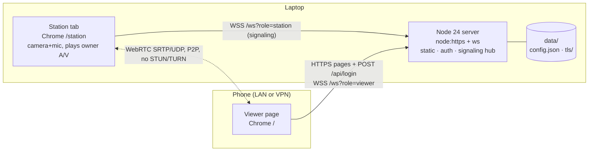

# PetCam — Architecture

Owner: Ari (Architect). Status: **v1.1**, which adds the approved security review items (M1–M3, L1–L3, L4-Origin, L5; see docs/SECURITY_REVIEW.md). Contract source of truth: `src/shared/protocol.ts`.

## 1. Context and goals
The app runs on one laptop and has one user. A Node server on the laptop serves HTTPS pages and relays WebRTC signaling. Media flows **peer-to-peer over the LAN** between two browser tabs:
- **Station**: the `/station` tab in Chrome on the laptop. It captures the laptop camera and mic, and it plays the owner's video and audio full-screen. It runs unattended.
- **Viewer**: the `/` page in Chrome on the phone (over the home VPN). It watches and listens, and it can send its own camera and mic ("Talk") or mic only (push-to-talk).

Goals: live video within about 3 s, recovery after network drops and server restarts with no action from the user, `npm install && npm start`, and no one else on the LAN can watch the camera.

## 2. Non-goals
Recording or snapshots. Motion alerts. More than one simultaneous viewer. More than one camera or station. Access from the internet without the VPN (no TURN or relays). User accounts. Native apps. iOS is best effort only. We test Chrome on Android and desktop.

## 3. Components



| Module | Owner | Responsibility |
|---|---|---|
| `src/server/main.ts` | Ben | Loads config and TLS, starts HTTPS and WS, prints the LAN URLs, shuts down gracefully (closes sockets with 1001). |
| `src/server/config.ts` | Ben | Reads env vars and `data/config.json`. Creates the password and session secret on first run. **Watches config.json and hot-reloads it** (§5). |
| `src/server/tls.ts` | Ben | Loads a user-supplied cert. Otherwise creates the persistent local CA once, and issues or reissues the leaf cert from it. |
| `src/server/auth.ts` | Ben | Verifies the password (scrypt), signs and verifies session cookies (HMAC), and rate-limits logins. These are pure functions and get unit tests. |
| `src/server/http.ts` | Ben | Routes, security headers, and static files served from an in-memory manifest. |
| `src/server/signaling.ts` | Ben | The WS hub. A pure state machine (roles, replacement, relay, validation, liveness), so we can unit-test it without sockets. |
| `src/server/set-password.ts` | Ben | CLI: `npm run set-password` and `npm run revoke-sessions` (`--revoke-sessions` flag). |
| `src/shared/protocol.ts` | Ari/Ben | Message types, constants, and the validators `parseClientMessage` / `parseRole`. |
| `src/shared/next.ts` | Ben | `sanitizeNext`, shared by the server and the login page (no `node:crypto`). |
| `src/client/lib/signaling.ts` | Fiona | Session preflight, WS connect/reconnect with backoff, ping/pong, typed send and receive. |
| `src/client/lib/peer.ts` | Fiona | Builds the RTCPeerConnection for each role, queues ICE candidates, detects failure. |
| `src/client/{login,viewer,station}.ts` + `pages/*.html`, `styles.css` | Fiona | The three pages. No framework. |

## 4. Repo layout and scripts
```
docs/  scripts/build.mjs  src/{server,client,shared}/  test/unit/  test/e2e/  playwright.config.ts
tsconfig.json (references) · tsconfig.base.json (strict, noUncheckedIndexedAccess, erasableSyntaxOnly) · tsconfig.server.json (node types, no DOM) · tsconfig.client.json (DOM, no node) · vitest.config.ts
data/   (runtime, gitignored)      dist/server/*.js · dist/public/*  (build output, gitignored)
```
`scripts/build.mjs` uses esbuild to bundle `src/server/{main,set-password}.ts` into `dist/server` (platform node, ESM, with `packages: 'external'`). It bundles `src/client/{login,viewer,station}.ts` into `dist/public/assets/` (browser, ES2022, minified, with sourcemaps). It also copies the HTML and CSS.

| Script | Command |
|---|---|
| `build` | `node scripts/build.mjs` |
| `start` | `node scripts/build.mjs && node --env-file-if-exists=.env dist/server/main.js` |
| `dev` | `build --watch` plus `node --watch` on dist (optional) |
| `set-password` | `node scripts/build.mjs && node dist/server/set-password.js` (prompts twice, needs **at least 12 chars**, and rejects a small embedded list of common passwords) |
| `revoke-sessions` | `node scripts/build.mjs && node dist/server/set-password.js --revoke-sessions` (rotates `sessionSecret` only) |
| `typecheck` | `tsc -b --noEmit` (or `tsc -p` each config) |
| `test:unit` | `vitest run test/unit` |
| `test:setup` | `PLAYWRIGHT_BROWSERS_PATH=.cache/ms-playwright playwright install chromium` (keeps browsers inside the repo) |
| `test:e2e` | `PLAYWRIGHT_BROWSERS_PATH=.cache/ms-playwright playwright test` |
| `test` | `npm run typecheck && npm run test:unit && npm run test:e2e` |

Runtime dependencies: `ws`, `@peculiar/x509` (**pinned to exactly 1.14.3**, the version verified by the spike; 2.x needs a `reflect-metadata` import) with `@peculiar/asn1-x509` and `@peculiar/asn1-schema`. These replace `selfsigned`, which is built on them but drops the nameConstraints extension (§5). Dev dependencies: `typescript`, `esbuild`, `vitest`, `@playwright/test`, `@types/node`, `@types/ws`. That is the whole list.

## 5. Config, secrets, TLS
- **Env vars** (an optional `.env` is loaded by Node's `--env-file-if-exists`; `.env.example` is committed): `PETCAM_PORT` (8443), `PETCAM_HOST` (`0.0.0.0`), `PETCAM_DATA_DIR` (`./data`), `PETCAM_PASSWORD` (plaintext, overrides the file, used by tests), `PETCAM_TLS_CERT` / `PETCAM_TLS_KEY` (paths to a user cert, e.g. from mkcert).
- **`data/config.json`** (directory mode 0700, `chmod`ed even if it already exists; file mode 0600; written atomically via tmp + rename) holds `{ "passwordHash": "scrypt$<N>$<r>$<p>$<saltB64>$<hashB64>", "sessionSecret": "<32 random bytes, base64>" }`. **First start without a password:** if `process.stdout.isTTY`, prompt for one (the same code and policy as `set-password`). Otherwise generate 16 chars with `crypto.randomInt` over a fixed alphabet, print it once with "change it with `npm run set-password`", and store only the hash. `set-password` and the first-run prompt enforce the policy (at least 12 chars, plus a common-password list). A weak `PETCAM_PASSWORD` only logs a startup warning, because the env var is for tests and advanced use. Never log request bodies or `Cookie` / `Set-Cookie` headers.
- **Session signing key** = `HMAC-SHA256(sessionSecret, "v1:" + verifier)`. The verifier is `PETCAM_PASSWORD` if set, otherwise `passwordHash`. Cookies survive a restart, because the station must stay logged in.
- **Revocation (hot):** `npm run set-password` rewrites `passwordHash` and logs out everyone. `npm run revoke-sessions` rotates only `sessionSecret`, for example after losing a phone. In both cases the running server **watches `config.json`** (`fs.watchFile`, 2 s polling) and reloads the hash and signing key. If the key changed, it closes **every** WS with **4401 UNAUTHORIZED**. If the file is unreadable or invalid, it keeps the old config and logs an error. If `PETCAM_PASSWORD` is set, `set-password` warns that the env var overrides the file. Both CLIs print "the station tab on this laptop must log in again". The user is at the laptop when running them anyway.
- **TLS, user cert:** if `PETCAM_TLS_CERT` and `PETCAM_TLS_KEY` are set (e.g. mkcert), use them as they are. `/ca.crt` returns 404.
- **TLS, default local CA:** use `@peculiar/x509` (ECDSA P-256, SHA-256). A working reference is in `docs/spikes/local-ca.cjs`, verified with openssl.
  - **CA** (`data/tls/ca.pem`, `ca-key.pem` 0600). It is created **once**, valid for 10 years. It is recreated, with a loud warning, only if either file is missing, the key doesn't match the cert, or the cert has expired. After a recreation the phone shows a warning again, and the README tells the user to remove the old CA from the phone and install and verify the new one. The README wording is: "remove every PetCam CA except the one whose name and fingerprint match the banner". Serial numbers for the CA and the leaf are random. CN **`PetCam Local CA (<hostname>, YYYY-MM-DD HH:MM UTC)`**, using the creation time (the comma is escaped in the DN string). Every CA generation has a unique name, so the user can tell a stale one apart on the phone (L6). `basicConstraints cA:true, pathLen:0` (critical), `keyUsage keyCertSign|cRLSign`, SKI. **`nameConstraints` (critical) permit only** DNS `localhost`, DNS `local` (which matches `*.local`), and IP `127.0.0.0/8`, `10.0.0.0/8`, `172.16.0.0/12`, `192.168.0.0/16`, `100.64.0.0/10` (CGNAT, e.g. Tailscale). As a result, a leaked CA key cannot impersonate any public site to the phone.
  - **Leaf** (`data/tls/cert.pem`, `key.pem` 0600). Valid for 397 days. `cA:false`, EKU serverAuth, AKI. SAN = `localhost`, `<hostname>.local`, `127.0.0.1`, plus every non-internal IPv4 **that falls inside the permitted ranges** (anything else, such as `169.254.x.x`, would fail the chain; log it and skip it). There is **no bare hostname**, since it would violate the CA's constraints. Reissue **only the leaf** on start if it is missing, a current eligible IP is not in its SAN, or it expires within 30 days. Since the CA stays the same, the phone never sees a new warning.
  - **`GET /ca.crt`** (public) serves the CA cert PEM as `application/x-x509-ca-cert` with `Content-Disposition: attachment; filename="petcam-ca.crt"`. The banner prints the LAN URLs, `https://<ip>:<port>/ca.crt`, the CA's **exact CN**, read from the cert, and the CA SHA-256 fingerprint **in the same format Android shows it**: `X509Certificate.fingerprint256` (uppercase colon-hex), split into 4 lines of 8 bytes. The README explains installing it on Android ("CA certificate"). It also says that after installing, the user should **never** see a cert warning: if one appears, don't proceed and don't type the password.
- **gitignored**: `data/ .env dist/ node_modules/ .cache/ test-results/ playwright-report/` (already in `.gitignore`).

## 6. HTTP API
Every response sets these headers: `Content-Security-Policy: default-src 'self'; img-src 'self' data:; media-src 'self' blob: mediastream:; object-src 'none'; base-uri 'none'; frame-ancestors 'none'; form-action 'self'`, `X-Content-Type-Options: nosniff`, `Referrer-Policy: no-referrer`, and `Permissions-Policy: camera=(self), microphone=(self), screen-wake-lock=(self)`. HTML and `/api/*` also get `Cache-Control: no-store`. The pages contain no inline scripts or styles.

**Rules that apply before routing:**
- **Origin**: every non-GET/HEAD request (and the WS upgrade) must carry `Origin` exactly equal to `https://<Host header>`, including the port. A missing or mismatched Origin gets 403 `{"error":"bad_origin"}`. Tests must send the header.
- **Loopback-only station**: `GET /station` and `role=station` upgrades require `req.socket.remoteAddress` ∈ {`127.0.0.1`, `::1`, `::ffff:127.0.0.1`}. Anything else gets 403. For the page, the 403 is a plain-text hint: "Open https://localhost:<port>/station on the laptop itself". This check runs before the auth check.
- Host validation (421) is deferred. The PLAN triage explains why.

| Method and path | Auth | Success | Errors |
|---|---|---|---|
| `GET /login` | public | 200 login page | – |
| `POST /api/login` with body `{"password":string}` | public + Origin | **204** + `Set-Cookie` | 403 `bad_origin`. 415 if Content-Type is not `application/json`. 400 `{"error":"bad_request"}` if the body is over 1 KB, is not JSON, or has no string `password`. 401 `{"error":"invalid_password"}`. 429 `{"error":"rate_limited","retryAfterSec":n}` + `Retry-After`. |
| `GET /api/session` | cookie | 200 `{"ok":true}` + **refreshed** `Set-Cookie` | 401 `{"error":"unauthorized"}` |
| `POST /api/logout` | Origin | 204, cookie cleared (`Max-Age=0`) | 403 `bad_origin` |
| `GET /` | cookie | 200 HTML | 302 to `/login?next=/` |
| `GET /station` | **loopback** + cookie | 200 HTML | 403 if not loopback. 302 to `/login?next=/station`. |
| `GET /ca.crt` | public | 200, the CA cert PEM (§5) | 404 when a user cert is configured |
| `GET /assets/<file>` | public (no secrets in bundles) | 200 from the in-memory map built at startup from `dist/public/assets`. **No request path ever reaches `fs`.** | 404 |
| `GET /healthz` | public | 200 `ok` | – |
| `GET /ws?role=station\|viewer` (Upgrade) | cookie + Origin (+ loopback for station) | 101 | 401 bad or missing cookie. 403 if `Origin` ≠ `https://<Host>`, or `role=station` from a non-loopback address. 400 bad role. 404 other path. |
| anything else | – | – | 404. 405 for a wrong method on a known path. |

- **Cookie**: `__Host-petcam_session=<expSec>.<base64url HMAC(key, "petcam:" + expSec)>; HttpOnly; Secure; SameSite=Strict; Path=/; Max-Age=2592000` (30 days, no `Domain`). The `__Host-` prefix makes the browser enforce all of these. To verify, `expSec` must match `/^\d{1,10}$/`. Compute the HMAC over that exact string and compare with `timingSafeEqual`. Reject if `exp < now` or `exp > now + 30 d + 60 s`. Every `GET /api/session` re-issues the cookie, so the station's sliding expiry never lapses.
- **Login page** reads `next`, which must be exactly `/` or `/station`, and otherwise falls back to `/` (no open redirect). It POSTs with `fetch` and then sets `location = next`.
- **Password check**: **async** `crypto.scrypt` (N=2^15, r=8, p=1, 32-byte salt, **`maxmem: 64 MiB`**, because the default throws on Node 24) with `timingSafeEqual`. Never use `scryptSync`. For `PETCAM_PASSWORD`, compare the SHA-256 digests with `timingSafeEqual`.
- **Rate limit**: in memory, keyed by `req.socket.remoteAddress` (no proxy, so ignore `X-Forwarded-For`). IPv4-mapped IPv6 is unwrapped, and IPv6 is keyed by its `/64`, because one host can use any address in its prefix.
  - **Count the attempt before `await scrypt`**, so parallel requests can't bypass the limit.
  - Allow **one in-flight attempt per IP**. Others get 429 immediately.
  - Once an IP has 5 attempts counted within 15 min, it gets 429 until the window ends. A successful login clears that IP's count.
  - **Global budget**: if there are more than 20 failures across all IPs within 15 min, every login is delayed by 2 s and a warning is logged. Logins from non-loopback addresses then go through a **single global queue** (delay + hash, one at a time), so the delay bounds the total guess rate (about one every 2 s) instead of being slept through in parallel from many addresses. At most 5 may be running or queued; more get 429 without being counted against their address. Loopback logins skip the queue, so the owner can always sign in at the laptop, and existing sessions are unaffected.
  - The map is capped at 1000 entries. When it is full, the oldest entry that is neither locked out nor in flight is evicted; if every entry is locked out or in flight, new addresses get 429. Cycling through addresses can't reset a lockout.
  - Unit test: 20 concurrent wrong logins from one IP make at most 5 scrypt calls.

## 7. Signaling protocol (WSS `/ws?role=…`, JSON text frames, types in `src/shared/protocol.ts`)

| Message | Direction | Server action |
|---|---|---|
| `{type:"peer",present:boolean}` | server → client | Sent on connect and whenever the counterpart connects or disconnects. |
| `{type:"offer",sdp:{type:"offer",sdp}}` | viewer → station | Relay |
| `{type:"answer",sdp:{type:"answer",sdp}}` | station → viewer | Relay |
| `{type:"candidate",candidate:{candidate,sdpMid,sdpMLineIndex}}` | both | Relay |
| `{type:"talk",audio:boolean,video:boolean}` | viewer → station | Relay |
| `{type:"ping"}` / `{type:"pong"}` | server → client / client → server | Liveness check. Never relayed. |

- **Server validation**: each frame must be ≤ 64 KB (`maxPayload`) and valid JSON. Its `type` must be allowed for the sender's role, and the fields must have the right types and sizes (SDP ≤ 32 K chars, candidate ≤ 1 K). The server **re-serializes only the known fields** and never forwards the raw frame. Any violation closes the socket with 4400. A frame over `maxPayload` is closed by `ws` itself with **1009**, and clients treat that like any other reconnectable close. **Flood limit**: more than 200 messages in 10 s from one socket closes it with 4400. If the counterpart is absent, the server drops the message silently.
- **Roles and multiplicity**: the server has at most one station and one viewer. **The newest connection wins.** A new station or viewer closes the previous socket with the same role using **4409 REPLACED**. That client shows "Opened elsewhere – Reconnect" and does **not** auto-reconnect, which avoids ping-pong between two tabs. The **counterpart receives `peer{present:false}` followed by `peer{present:true}`**, so it tears down and rebuilds its session (§8). Newest-wins means a phone that switches networks never gets locked out by its own stale socket. Only a loopback client can take the station role (§6), so a phone, or someone who knows the password, can't kick out the real station.
- **Revocation**: when the signing key changes (§5), the server closes every socket with **4401 UNAUTHORIZED**. Auth is otherwise checked only at upgrade.
- **Liveness**: the server sends `ping` every 15 s. **Any valid inbound message** counts as liveness. The server checks every 5 s and terminates a socket that has been silent for 40 s (so in practice after 40–45 s), which then triggers `peer:false` for the counterpart. A client that receives no `ping` for 40 s closes and reconnects. (Browsers expose no protocol pings, and handling `ping` in `onmessage` is not subject to background timer throttling.)

## 8. WebRTC negotiation
**Only the viewer creates offers, and there is never renegotiation.** That rules out glare and removes the need for "perfect negotiation".

```mermaid
sequenceDiagram
  participant V as Viewer (phone)
  participant H as Server
  participant S as Station (laptop)
  S->>H: WS connect (role=station)  [camera+mic already captured]
  V->>H: GET /api/session → 200, then WS connect (role=viewer)
  H-->>V: peer{present:true}
  H-->>S: peer{present:true}
  Note over V: new RTCPeerConnection({iceServers:[]})<br/>addTransceiver('audio',sendrecv)<br/>addTransceiver('video',sendrecv)  — no tracks yet
  V->>H: offer → S
  Note over S: close any old PC, new PC, setRemoteDescription<br/>addTrack(mic), addTrack(cam) (reuses the transceivers)
  S->>H: answer → V
  V-->>S: candidate* (trickle, both ways, via H)
  S-->>V: SRTP: laptop A/V (viewer video autoplays muted; "Tap for sound")
  Note over V: Talk: getUserMedia → sender.replaceTrack(track) (no renegotiation)
  V->>H: talk{audio:true,video:true} → S (show full-screen video, unmute)
  Note over V: Stop: replaceTrack(null), stop tracks, talk{false,false}
```

- **Peer setup**: `iceServers: []`. Both sides queue remote candidates until `remoteDescription` is set, then flush. Don't send end-of-candidates (null).
- **Station**: acquires camera and mic **once**, on its "Start station" click. That click is also the user gesture that unlocks audio autoplay. Constraints: `video {width:1280,height:720,frameRate:30}`, `audio {echoCancellation:true, noiseSuppression:false, autoGainControl:true}`. noiseSuppression is off so barking isn't filtered out. Every incoming `offer` means a new session: close the old PC, build a new one, and reset talk to off. The station plays the viewer's tracks in one `<video>` element, shown or hidden according to `talk`. If the camera track ends (device unplugged), it re-runs getUserMedia and calls `replaceTrack` on the live senders. It holds a Screen Wake Lock and re-acquires it on `visibilitychange`.
- **Viewer talk modes**: *Talk* (camera `facingMode:'user'` + mic) and *Push-to-talk* (mic only, held down). PTT acquires the mic on the first press and then toggles `track.enabled`, and it sends `talk{audio:pressed,video:false}` on each change. *Stop* releases all phone tracks. Each `talk` must follow its `replaceTrack` resolving.
- **Reconnect rules (both clients, all handled in the page, never `location.reload()`, so the station keeps its autoplay unlock):**
  - WS closes with **4401**: tear down the PC and go straight to `/login?next=…`, with no backoff loop.
  - WS closes with **4409**: tear down the PC and show "Opened elsewhere – Reconnect". Don't auto-reconnect.
  - WS closes with any other code: tear down the PC. Retry with backoff 1, 2, 4, 8, then 10 s maximum, ±20 % jitter. Before each attempt, call `GET /api/session`. A 401 sends the client to `/login?next=…`. A network error means retry.
  - `peer{present:false}`: tear down the PC and show "Station offline" (viewer) or "Idle" (station).
  - `peer{present:true}`: the viewer builds a new PC and offers. The station waits.
  - PC `connectionState` is `failed`, or stays `disconnected` for more than 5 s: the viewer tears down and re-offers on the same WS. The station handles the new offer as a new session.
  - Any PC teardown resets talk to off on both sides. The user taps Talk again.

## 9. Security boundaries (for Sam)
1. **Trust boundary = HTTPS listener on 0.0.0.0:8443.** Everything else on the LAN or VPN is untrusted. Only `/login`, `/api/login`, `/api/logout`, `/assets/*`, `/ca.crt` and `/healthz` are reachable without a valid cookie. Every non-GET request needs a same-origin `Origin`.
2. **AuthN**: one shared password (at least 12 chars), stored as a scrypt hash. Logins are rate-limited per IP, counted before hashing, with a global delay budget. Sessions are stateless HMAC cookies (`__Host-`, HttpOnly, Secure, SameSite=Strict, 30 days). Revocation (`set-password` or `revoke-sessions`) takes effect **live**: config hot-reload, then 4401 to every socket.
3. **AuthZ**: the WS upgrade checks the cookie **and** the `Origin` (defence against CSWSH). The **station role and `/station` are loopback-only**, so a remote client can never receive the owner's phone camera. Any authenticated remote client can be the viewer.
4. **Untrusted input**: login body, `next` param, WS frames (validated, size-capped, re-serialized), request paths (static files come from a map, not from `fs`). SDP and candidate strings are passed opaquely to the peer browser, which parses them.
5. **Secrets**: `data/config.json` (hash + session secret), `data/tls/key.pem` and **`data/tls/ca-key.pem`** (all 0600; the CA key is name-constrained to private names and IPs), plus `.env`. All are gitignored. The plaintext password is never logged, except the generated first-run password when there is no TTY.
6. **Media** is DTLS-SRTP end to end between the two browsers and never touches the server. ICE exposes LAN IPs to the authenticated peer, which is acceptable.
7. **TLS trust**: the phone installs the local CA once. **Preferred path:** download `https://localhost:<port>/ca.crt` *on the laptop*, where loopback can't be intercepted, and transfer it to the phone via Quick Share or USB. **Second option:** download it in the phone browser. That first download happens over the not-yet-trusted connection. An attacker who substitutes the file there gets an **unconstrained root, which means MITM of all the phone's HTTPS traffic**, so the check is **mandatory**. After installing, open Settings → Trusted credentials → User. The name must be exactly the CN printed in the banner (`PetCam Local CA (<hostname>, YYYY-MM-DD HH:MM UTC)`), and the SHA-256 fingerprint must match the laptop banner exactly. **If it doesn't match exactly, remove the certificate and stop.** After that, a cert warning means an attack. On the laptop itself, clicking through once for `https://localhost` is acceptable, because loopback traffic can't be intercepted from the LAN. Importing the CA into Chrome's certificate settings is optional.
8. **Accepted risks**: a password holder can DoS by repeatedly taking the viewer slot. If the VPN NATs clients, they all share one IP, so an attacker on the VPN can delay the owner's new logins for 15 min.

## 10. Testing
- **Unit tests (vitest)**: auth (scrypt verify, cookie sign/verify/expiry/tamper, rate limiter), signaling hub (relay matrix per role, 4400 on bad messages, 4409 replacement, `peer` notifications, liveness with fake timers), `next` sanitising, TLS SAN regeneration decision. Security additions:
  - concurrent logins make at most 5 scrypt calls;
  - an old cookie fails after a key change, and the hub closes sockets with 4401;
  - strict `exp` parsing;
  - Origin is required on POST;
  - non-loopback `role=station` and `/station` get 403;
  - the generated leaf chains to the CA, and the CA has nameConstraints.
- **E2E (Playwright Chromium)** with `--use-fake-device-for-media-stream --use-fake-ui-for-media-stream --autoplay-policy=no-user-gesture-required`, `ignoreHTTPSErrors`, the server on a random free port, a temporary `PETCAM_DATA_DIR`, and `PETCAM_PASSWORD=test-password-123`. Station and viewer each get their own browser context. Assertions:
  - The viewer's `inbound-rtp` video `framesDecoded` increases within 5 s.
  - After Talk, the station's inbound video increases.
  - PTT produces inbound audio on the station.
  - Restarting the server makes both reconnect and video resume.
  - Unauthenticated WS and pages are rejected.
  - A second viewer replaces the first with 4409.
  - Running `revoke-sessions` while connected sends both pages to `/login`.
- Expose `data-state` attributes on the page root for the tests (`connecting | offline | live | talking`).

## 11. Riskiest assumptions → how to de-risk
| # | Assumption | De-risk (do first) | Fallback |
|---|---|---|---|
| 1 | The phone on the VPN can reach the laptop's LAN IP over UDP with no STUN. The phone's own candidates are mDNS-obfuscated until it grants the camera, but the laptop learns its address as a peer-reflexive candidate. | Day-1 spike: a bare page pair on a real phone over the VPN. Check `chrome://webrtc-internals`. Make sure the laptop firewall allows Chrome's inbound UDP. | Document the firewall rule. A coturn on the laptop is an out-of-scope v2 item. |
| 2 | Chrome on Android trusts a user-installed, name-constrained CA for `https://<LAN IP>` (getUserMedia and WSS work with no warning). openssl accepts the chain (`docs/spikes/local-ca.cjs`). | Manual check on a real phone, from the README acceptance checklist. Sam verified the chain with openssl only, since Chromium's verifier couldn't be seeded here. | If Android rejects the critical nameConstraints, **drop the constraints** (keep the CA). Do not go back to click-through. `PETCAM_TLS_CERT/KEY` with mkcert remains the alternative. |
| 3 | The station plays incoming audio unattended after a single "Start" click, across reconnects. | Manual test: start the station, restart the server, then Talk from the phone (E2E hides this with the autoplay flag). | Show a full-screen "Click to enable sound" overlay when `play()` rejects. Document the Chrome flag. |
| 4 | Chrome doesn't throttle or discard the station tab. | Keep the station visible: its own window, full-screen, with the wake lock. Run a soak test overnight with the laptop on AC power and OS sleep disabled. | README section on laptop power and lid settings. |
| 5 | Echo cancellation suppresses loop-back when both ends use speakers. | Manual test with the phone on speaker. | Default the phone to PTT-style half-duplex. |
